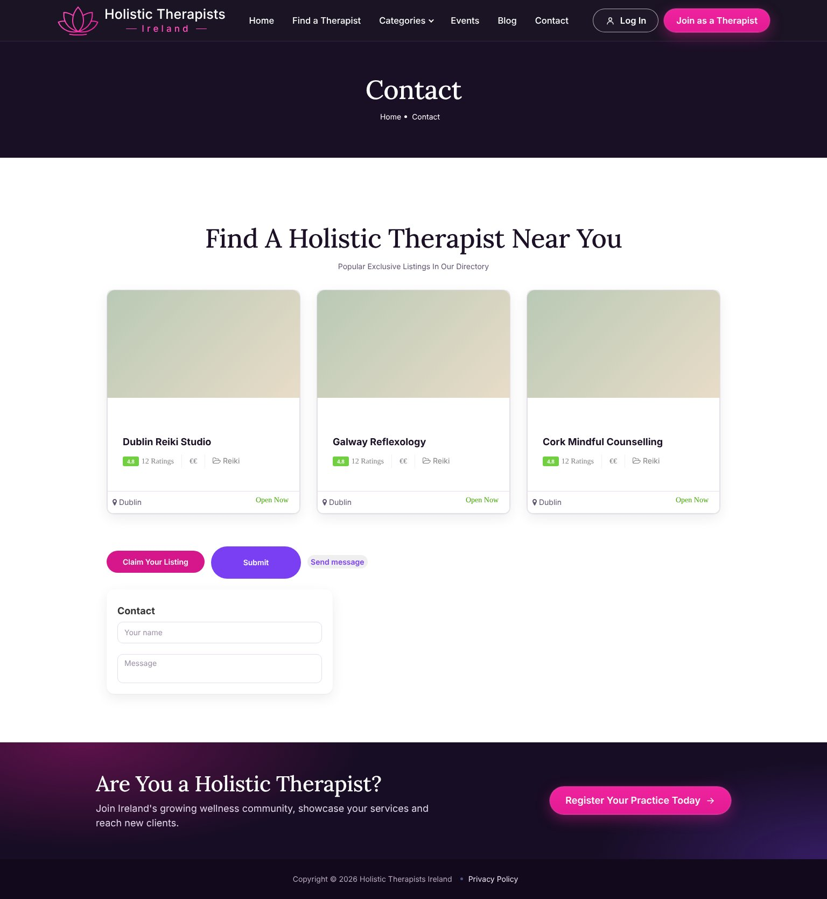

# HT Neon

Wtyczka WordPress, która nakłada ciemny, fioletowo-różowy wygląd na motyw **ListingPro** na stronie holistictherapists.ie. Nie zmienia plików motywu, wizytówek ani treści stron. Po wyłączeniu wtyczki strona wraca do poprzedniego wyglądu.

## Zrzuty ekranu

Wyrenderowane lokalnie na stylach ListingPro z przykładowymi danymi.

**Strona główna**

**Podstrona**

**Telefon**

Cała strona główna: [screenshots/home-full.jpg](screenshots/home-full.jpg)

## Co robi

- **Nagłówek z logo** (lotos + „Holistic Therapists — Ireland —"), menu, „Log In" i przycisk „Join as a Therapist". Zastępuje nagłówek motywu.
- **Nowa strona główna**: baner z wyszukiwarką podpiętą pod wyszukiwanie ListingPro, cztery zalety, kafelki kategorii, dwa boksy z zachętą, liczniki, ostatnio dodane wizytówki i wpisy z bloga. Dotychczasowa strona główna (Elementor) zostaje nietknięta.
- **Podstrony**: ciemny wygląd całego ListingPro (generowany automatycznie z arkuszy motywu), baner „Are You a Holistic Therapist?" przed stopką. Ciemne podstrony można wyłączyć w ustawieniach.
- **Stopka** z logo, linkami i mediami społecznościowymi z opcji motywu. Zastępuje stopkę motywu.
- **Nadchodzące wydarzenia** (typ wpisu `events` z ListingPro) na stronie głównej.
- **Liczniki** pokazują prawdziwą liczbę opublikowanych wizytówek i kategorii.

## Instalacja

1. Pobierz repozytorium jako ZIP (*Code → Download ZIP*).
2. W WordPressie: *Wtyczki → Dodaj nową → Wyślij wtyczkę na serwer*, wybierz plik ZIP, potem *Włącz*.

Wymagania: WordPress 6.0+, PHP 7.4+, aktywny motyw ListingPro. Przy innym motywie wtyczka nic nie zmienia.

## Tryb podglądu

Po włączeniu wtyczka działa w trybie **Podgląd**: nowy wygląd widzą tylko zalogowani administratorzy. Bez logowania podgląd działa pod adresem `/?ht_preview=1`.

Ustawienia są w *Wygląd → HT Neon*:

- tryb: Podgląd / Włączony / Wyłączony,
- włączanie i wyłączanie nagłówka, stopki, strony głównej, ciemnych podstron, wydarzeń, liczników, banera i paska rejestracji,
- napis i adres przycisku rejestracji (domyślnie `/pricing-plan/`),
- własne zdjęcie w banerze.

Własne menu w nagłówku: *Wygląd → Menu → Zarządzaj położeniem*, pozycja „HT Neon – menu w nagłówku". Bez tego nagłówek pokazuje menu domyślne.

## Struktura

- `ht-neon.php` – ustawienia, nagłówek, podmiana szablonu strony głównej, baner rejestracji
- `templates/home.php` – strona główna
- `assets/css/colors.css` – kolor akcentu podmieniony w selektorach ListingPro
- `assets/css/dark-auto.css` – ciemne nadpisania wygenerowane z arkuszy ListingPro, Bootstrapa i bibliotek
- `assets/css/dark.css` – paleta i podstawy ciemnych podstron
- `assets/css/skin.css` – kształty, czcionki i karty na podstronach
- `assets/css/pages.css` – ciemna mapa, lista terapeutów, wizytówka, kontakt, blog, okna logowania
- `assets/css/dashboard.css` – panel użytkownika w kolorach marki
- `assets/css/neon.css` – nagłówek, stopka, strona główna, baner
- `assets/js/neon.js` – menu mobilne, okienko logowania, pasek rejestracji
- `assets/img/` – zdjęcia banera, kafelków i boksów

## Status

Wtyczka była sprawdzana lokalnie na stylach ListingPro 2.9.12 z przykładowymi danymi, jeszcze nie na działającej stronie.
